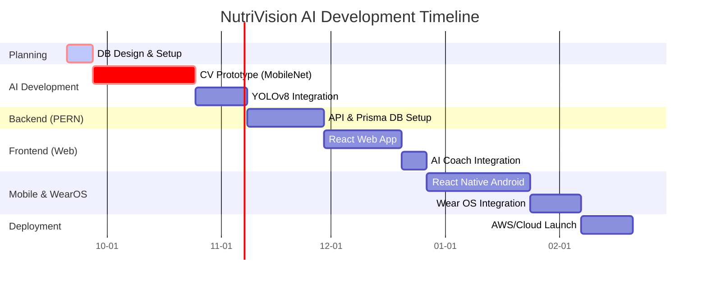

# Implementation Plan & Roadmap 🗺️

This roadmap sequences development to prove the high-risk AI features first, followed by the backend, and eventually the client applications. 

## Project Timeline (Gantt Chart)

## Phase 1: Planning, Environment & DB Design (Completed ✅)
*   **Goal**: Set up the environment and finalize the relational database schema.
*   **Delivered**:
    *   Initialized Git repository with `main` and `dev` branches.
    *   Configured PostgreSQL database with 16 normalized tables in 3NF.
    *   Set up Node.js/Express environment with Prisma ORM and seed scripts.

## Phase 2 & 3: Computer Vision & Depth Pipeline (Completed ✅ — ADR-009)
*   **Goal**: Detect multi-item plates and estimate portion volume without heavy GPU hosting.
*   **Delivered**:
    *   Integrated Roboflow hosted IndianFoodNet model for accurate Indian cuisine multi-food detection.
    *   Integrated MiDaS `DPT_Hybrid` relative depth estimation with plate center depth heuristics.
    *   Mapped class labels to canonical PostgreSQL `food_items.food_id`s in `ai-service/src/app.py`.
    *   Wrapped in a Dockerized Python FastAPI microservice with internal token authentication.

## Phase 4: Backend API & Database Implementation (Completed ✅)
*   **Goal**: Build the core Node.js backend meeting university criteria.
*   **Delivered**:
    *   Implemented Express API with Prisma ORM connecting to PostgreSQL.
    *   Created Auth endpoints (Google OAuth, JWT, BCrypt password hashing, and dev login bypass).
    *   Implemented atomic `sp_log_meal` stored procedure and 3 database triggers (`trg_update_search_vector`, `trg_update_daily_log`, `trg_set_updated_at`).
    *   Created SQL views (`vw_user_daily_summary`, `vw_food_full`).
    *   Built complete CRUD operations for Meals, Users, Activity, and Biometric Profiles.

## Phase 5: React Web Application & Modern UI Redesign (Completed ✅)
*   **Goal**: Build the user-facing web dashboard with clinical-grade visual hierarchy, dark luxury aesthetic, and modular component primitives.
*   **Delivered**:
    *   Built modern React 19 + Vite 8 + Tailwind CSS v4 frontend with emerald ambient lighting and dark glassmorphic styling.
    *   Implemented modular UI primitive library in `frontend-web/src/components/ui/` (`Card`, `Button`, `Badge`, `ProgressRing`, `Skeleton`).
    *   Architected a **Sidebar + Main Content** composition featuring a persistent **Daily Metabolic Ledger** control bar with quick date navigation, remaining calories, steps, and instant meal logging.
    *   Implemented SVG circular calorie intake dial, macro target progress bars, Recharts 7-day caloric trajectory bar chart, and macro distribution donut chart.
    *   Built dual-mode Meal Logging UI with photo plate analysis, portion weight adjustments, and dual-source food search (ICMR IFCT 2017 + USDA).
    *   Built historical meal calendar timeline with macro breakdown badges and deletion cascade.
    *   Integrated physical activity logger with presets and live Mifflin-St Jeor TDEE profile manager.

## Phase 6: AI Nutrition Coach & Multimodal Vision Cascade (Completed ✅)
*   **Goal**: Add real-time "Explain My Plate" dietary coaching and robust computer vision plate analysis.
*   **Delivered**:
    *   Engineered a high-availability Google Gemini model cascade (`gemini-3.5-flash-lite`, `gemini-3.5-flash`, `gemini-3.8-flash`, `gemini-3.1-flash-lite`) to guarantee sub-second responses and eliminate 503 high-demand spike bottlenecks.
    *   Implemented `POST /api/coach/explain` and `GET /api/coach/daily-insight` endpoints in `coachController.ts` with contextual database extraction (profile goals, daily macros, meal history).
    *   Built conversational `NutritionCoach.tsx` chat interface with live macro snapshots and intelligent dietary prompts.
    *   Created `NutriCoachWidget.tsx` embedded on the Dashboard that automatically triggers whenever a meal is logged or updated, with sessionStorage caching.
    *   Equipped `analyzeMeal` with primary Gemini multimodal vision detection and secondary Roboflow IndianFoodNet + MiDaS depth fallback.

## Phase 7: React Native & Wear OS (Weeks 16-20)
*   **Goal**: Bring the app to mobile and smartwatches.
*   **Tasks**:
    *   Build the Android App using React Native (reuse API).
    *   Implement camera functionality for easy meal scanning.
    *   Integrate Google Fit API for steps/calories burned.
    *   Build Wear OS companion app displaying daily remaining calories.

## Phase 8: Deployment & CI/CD (Weeks 21-22)
*   **Goal**: Launch to the cloud.
*   **Tasks**:
    *   Deploy Database to a managed service (e.g., Supabase, Aiven).
    *   Deploy Node Backend & AI FastAPI (Railway or Render).
    *   Deploy React Web (Vercel).
    *   Set up GitHub Actions for CI/CD pipeline (Bonus marks).
