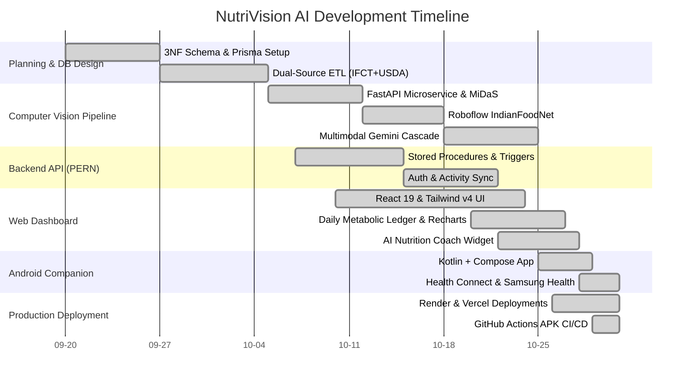

# Implementation Plan & Roadmap 🗺️

This roadmap outlines the phased development of NutriVision AI, from database modeling and multimodal computer vision to the web dashboard, native Android companion, and cloud production deployment.

## Project Timeline (Gantt Chart)

---

## Phase 1: Planning, Environment & 3NF Relational DB Design (Completed ✅)
* **Goal**: Establish core repository infrastructure, 3NF PostgreSQL database, and initial data seeding.
* **Delivered**:
  - Initialized Git monorepo with semantic commit standards and branch protection.
  - Architected 16 normalized relational tables in Third Normal Form (3NF) (`users`, `user_profiles`, `meals`, `meal_items`, `food_items`, `food_nutrients`, `nutrient_types`, `daily_logs`, `ai_match_log`, etc.).
  - Configured Prisma ORM with PostgreSQL 15/16 and initial seed scripts.

## Phase 2 & 3: Computer Vision & Depth Estimation Pipeline (Completed ✅ — ADR-009)
* **Goal**: Enable multi-item food detection and volume-scaled portion estimates on free-tier infrastructure.
* **Delivered**:
  - Integrated hosted Roboflow IndianFoodNet API for accurate classification of 30+ regional Indian dishes.
  - Implemented MiDaS `DPT_Hybrid` relative depth estimation with plate-level depth heuristics in `ai-service/src/depth.py`.
  - Mapped food classes to canonical PostgreSQL `food_items.food_id`s in `ai-service/src/app.py`.
  - Containerized Python 3.11 FastAPI service secured via shared internal token (`X-Internal-Token`).

## Phase 4: Backend API & Database Implementation (Completed ✅)
* **Goal**: Build high-performance Express/Node.js API satisfying academic database criteria.
* **Delivered**:
  - Implemented Express API in TypeScript with Prisma ORM connecting to PostgreSQL.
  - Created authentication endpoints (Google OAuth, JWT signing, developer bypass, and companion email login).
  - Authored atomic PostgreSQL stored procedure `sp_log_meal` encapsulating meal creation, nutrient scaling, and daily log balance recalculation.
  - Created 3 PostgreSQL triggers (`trg_update_search_vector`, `trg_update_daily_log`, `trg_set_updated_at`) and 2 SQL views (`vw_user_daily_summary`, `vw_food_full`).
  - Built comprehensive CRUD operations for Meals, Users, Activity, and Biometric Profiles.

## Phase 5: React Web Application & Modern Luxury UI Redesign (Completed ✅)
* **Goal**: Deliver a clinical-grade, modern web dashboard with emerald ambient glows and responsive hierarchy.
* **Delivered**:
  - Built modern React 19 + Vite 8 + Tailwind CSS v4 frontend with dark luxury styling.
  - Modular UI primitive library in `frontend-web/src/components/ui/` (`Card`, `Button`, `Badge`, `ProgressRing`, `Skeleton`).
  - Implemented persistent **Daily Metabolic Ledger** control bar with calendar date navigation, remaining calories, steps, and instant meal logging.
  - Created SVG circular calorie intake dial, macronutrient target bars, Recharts 7-day caloric trajectory charts, and macro distribution donut visualizations.
  - Built dual-mode Meal Logging UI with photo plate analysis, portion weight adjustments, and dual-source food search (ICMR IFCT 2017 + USDA).
  - Implemented Mifflin-St Jeor TDEE profile manager with dynamic physical expenditure calibration.

## Phase 6: AI Nutrition Coach & Multimodal Vision Cascade (Completed ✅)
* **Goal**: Add conversational AI dietary coaching and robust multimodal food recognition.
* **Delivered**:
  - Engineered high-resilience Google Gemini vision cascade (`gemini-flash-lite-latest`, `gemini-3.1-flash-lite`, `gemini-flash-latest`, `gemini-3.5-flash`) eliminating 503 high-demand spike bottlenecks.
  - Implemented `POST /api/coach/explain` and `GET /api/coach/daily-insight` in `coachController.ts` extracting user biometrics, goal macros, and daily meals.
  - Built `NutritionCoach.tsx` conversational chat screen and `NutriCoachWidget.tsx` embedded on Dashboard with automatic post-logging refresh and session caching.
  - Dynamic food creation with database sequence auto-synchronization (`syncDatabaseSequences`) and zero false "rice guessing".

## Phase 7: Native Android Companion App & Samsung Health Sync (Completed ✅ — ADR-010)
* **Goal**: Bridge real-time step and exercise data from Samsung Health into the web dashboard with zero background battery drain.
* **Delivered**:
  - Developed native Android Companion application (`mobile-app/`) in Kotlin + Jetpack Compose (`compileSdk = 35`, Java 17).
  - Integrated official Google Health Connect API (`androidx.health.connect:connect-client:1.1.0-alpha11`) using `HealthConnectClient.aggregate(StepsRecord.COUNT_TOTAL)` for verified, deduplicated Samsung Health counts.
  - Strictly on-demand execution: runs 0 background services or polling daemons, ensuring 0% idle battery consumption.
  - Seamless account pairing via Google email (`/api/auth/companion-login`) and deep link `nutrivision://connect?token=...`.
  - One-tap push action sending verified steps and active calories to `POST /api/activity/sync`, dynamically expanding remaining daily calories on the web platform.
  - Automated cloud APK compilation via GitHub Actions (`.github/workflows/build-apk.yml`), compiling debug APK with Gradle 8.7 and publishing release `companion-latest/NutriVisionSync.apk`.
  - Added direct 1-tap APK download button to web navbar, mobile drawer, and Activity page.

## Phase 8: Cloud Production Deployment & CI/CD Automation (Completed ✅)
* **Goal**: Launch all platform services to live cloud production environments.
* **Delivered**:
  - **Live Web Dashboard**: Deployed on Vercel at [https://nutrivision-ai-mu.vercel.app](https://nutrivision-ai-mu.vercel.app).
  - **Live Backend API**: Deployed on Render at [https://nutrivision-backend-i9x2.onrender.com](https://nutrivision-backend-i9x2.onrender.com).
  - **Managed Database**: Cloud PostgreSQL database on Neon with 16 normalized tables in 3NF, triggers, views, and stored procedures.
  - **Automated CI/CD**:
    - Backend test suite with PostgreSQL 15 container in GitHub Actions (`.github/workflows/ci.yml`).
    - Android APK build and GitHub Release automation (`.github/workflows/build-apk.yml`).
  - **Direct Companion APK Release**: Hosted on GitHub Releases for immediate installation on any Android 10+ device.
